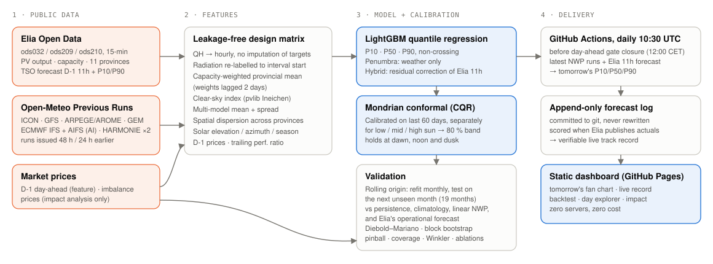

# Penumbra: day-ahead solar forecasts that know when they're unsure

**DataNova 2026 Global Data-thon · Track: Sustainability · Problem DN-SU-01 Solar Energy Generation Forecasting**

Penumbra forecasts tomorrow's hourly output of Belgium's ~12 GW photovoltaic fleet. It uses eight archived weather models, one of them ECMWF's machine-learned AIFS, and puts a conformally calibrated 80 % band around every hour. It is scored against the grid operator's own operational forecast in two ways: a 19-month backtest with no look-ahead, and a public live track record where each day's forecast is appended to a log and never edited.

- **Live dashboard:** https://s-kkipie.github.io/penumbra-solar-forecast/ (redirects to https://skkippie.me/penumbra-solar-forecast/)
- **Full evaluation report:** [`docs/EVALUATION.md`](docs/EVALUATION.md)
- **Presentation:** [`submission/Penumbra_DataNova2026.pptx`](submission/Penumbra_DataNova2026.pptx) ([PDF](submission/Penumbra_DataNova2026.pdf))



## Results at a glance

Out-of-sample, 575 days (Apr 2025 to Oct 2026), 7,659 daylight hours. Every method is scored on the same hours. nMAE is the mean absolute error as a % of installed capacity.

| | Elia operational D-1 11h | **Penumbra Hybrid** | **Penumbra weather-only** |
|---|---:|---:|---:|
| nMAE, strict inputs (weather runs issued 48 h before each hour) | 2.87 % | **2.88 %** (DM p = 0.98) | 3.50 % |
| nMAE, optimistic inputs (runs issued 24 h before each hour) | 2.87 % | **2.74 %**, 4.6 % better (DM p = 0.010) | 3.08 % |
| 80 % band coverage (strict) | 80.1 % | **81.2 %** | 79.7 % |
| Mean band width, % of capacity (strict) | 12.5 | **8.9**, 29 % narrower | 10.9 |
| Winkler interval score (strict, lower is better) | 14.70 | **13.18**, 10.4 % better | 15.80 |
| Mean pinball loss P10/P50/P90 (strict) | 0.969 | **0.919** | 1.110 |
| Coverage when the forecast says overcast (strict) | 62 % | **89 %** | 90 % |

What the numbers show:
- **Point accuracy matches the grid operator.** With strict inputs the Hybrid ties Elia's forecast; there is no statistically significant difference. With fresher inputs it is 4.6 % better, and that difference is significant. The live system uses runs that are 18 to 42 h old, so its accuracy should fall between the two settings. The live track record measures it directly.
- **The uncertainty band is much sharper.** At the same coverage, Penumbra's 80 % band is 29 % narrower than Elia's P10 to P90 band, about 445 MW at today's capacity. Under forecast-overcast skies, Elia's band covers only 62 % of hours, where 80 % is the target. Penumbra stays at or above 80 % in every sky regime.
- **The weather-only model uses free data only.** It needs no input from the grid operator and is 55 % better than persistence. This is the version that can be ported to grids without a professional forecaster (see *Scalability*).

## The problem

Day-ahead positions for Belgium close at 12:00 CET on D-1. Every MW of solar forecast error must later be balanced in real time, mostly by gas plants, and settled at imbalance prices. Installed PV in Belgium grew from 9.1 to 12.1 GW between April 2024 and October 2026, so solar is now the largest source of day-ahead uncertainty on the grid. Two groups need more than a single number:
- **TSOs and DSOs** size balancing reserves from forecast uncertainty. If the uncertainty estimate is badly calibrated, they hold reserve that is not needed, or they are short of reserve when it is.
- **Balance-responsible parties and aggregators** bid in the day-ahead market and pay for their deviations from the bid.

DN-SU-01 asks for *"a forecasting model with horizon-based predictions and an uncertainty estimate"* to *"support grid stability and renewable planning"*. Penumbra does that on real operational data and compares itself against the forecast that the operator actually uses.

## Data (all public, real, verifiable)

| Source | Content | Use | Licence |
|---|---|---|---|
| [Elia Open Data](https://opendata.elia.be) ods032, ods209, ods210 | Upscaled measured PV (MW), monitored capacity, 11 provinces + national, 15-min; Elia's D-1 11:00 forecast with P10/P90 | target, benchmark, capacity weights | Elia Open Data Licence |
| [Open-Meteo Previous Runs API](https://open-meteo.com/en/docs/previous-runs-api) | GHI, direct radiation, cloud cover, 2 m temperature from ICON, GFS, ARPEGE/AROME, ECMWF IFS, **ECMWF AIFS**, KNMI and DMI HARMONIE, GEM, archived at fixed 24 h / 48 h lead, 11 provincial points | features | CC BY 4.0 (free non-commercial API) |
| [Energy-Charts API](https://api.energy-charts.info) (Fraunhofer ISE, SMARD) | Belgian day-ahead prices | D-1 price features; impact analysis | CC BY 4.0 |
| Elia Open Data ods134 | Quarter-hour imbalance prices | impact analysis only | Elia Open Data Licence |

**Data quality** (`reports/data_quality.json`): 22,409 of 22,608 hours have a complete target. The missing 0.88 % are dropped and never imputed. That leaves 12,273 daylight hours. Weather-model gaps are 0 to 0.16 %; the AIFS archive starts in March 2025, and LightGBM handles the earlier missing values natively. The newer Elia datasets store numbers as text with decimal commas, and they also contain empty placeholder rows for future quarter-hours. Both cases are handled in `src/penumbra/elia.py` and covered by its logic.

## Method

1. **Time alignment.** Quarter-hours are averaged to hours only when all four exist. Open-Meteo radiation is a mean over the *preceding* hour, so it is re-labelled to the interval it describes. A check confirms that correlation with output peaks at zero lag.
2. **Features** (`src/penumbra/features.py`):
   - each weather model's irradiance, averaged over provinces with weights equal to their share of installed PV;
   - mean and **spread** across models, as an uncertainty signal;
   - clear-sky index from pvlib's Ineichen model;
   - plane-of-array irradiance for south-facing 35° roofs and flat east-west roofs;
   - spatial dispersion of the forecast across provinces;
   - solar geometry;
   - weekend and holiday flag;
   - a **trailing 14-day performance ratio** ending D-2, which adapts to fleet drift;
   - **yesterday's day-ahead prices**. Negative prices cause PV curtailment and tend to persist from one day to the next. These prices are published at D-2 13:00, so they are known in time.
3. **Model** (`src/penumbra/model.py`): LightGBM quantile regression for P10, P50 and P90 of the capacity factor. The quantiles are sorted so they never cross.
   - *Weather-only* uses only the features above.
   - *Hybrid* learns a **residual correction** on top of Elia's 11:00 forecast, which is published at the same moment as Penumbra's input cut-off.
4. **Calibration.** Split-conformal quantile regression (CQR, Romano et al. 2019), run separately for low, mid and high sun ("Mondrian"). It uses the last 60 days before each test month. This gives a finite-sample coverage guarantee under exchangeability.

### Validation protocol (no look-ahead, unit-tested)
- **Rolling-origin backtest.** For each test month M: fit on hours before M minus 60 days, calibrate on the 60 days before M, freeze the model, and predict M. There are 19 test months. `tests/test_core.py` asserts that no fit ever sees the test month.
- **Strict inputs.** Weather runs issued 48 h before each hour, all available before Elia's D-1 11:00 forecast. Installed capacity is lagged 2 days. Price features come from the previous delivery day. These rules are also unit-tested.
- **Baselines:** persistence (D-2), month-by-hour climatology, linear NWP regression, and **Elia's operational D-1 11:00 forecast**.
- **Metrics:**
  - point: nMAE, nRMSE, bias, MW;
  - probabilistic: coverage, width, Winkler score, pinball loss;
  - breakdowns by month, season, hour and sky regime.
- **Significance:** Diebold–Mariano test on daily loss differentials with Newey–West variance, plus a 95 % moving-block bootstrap of the nMAE difference.
- **Hyperparameters** were fixed in advance and never tuned on test months. One round of feature design happened after the first backtest; it is disclosed in `docs/EVALUATION.md` together with ablations.

### Ablations (strict, weather-only median model)
| Variant | nMAE % |
|---|---:|
| Full model (8 NWP models) | 3.50 |
| without ECMWF AIFS (the AI weather model) | 3.60 (+3.0 %) |
| without market features | 3.55 (+1.6 %) |
| without multi-model spread / dispersion | 3.51 (+0.4 %) |
| ECMWF IFS only | 3.93 (+12.2 %) |
| ICON only | 4.29 (+22.7 %) |

## Impact (`src/penumbra/impact.py`, assumptions stated)
- **Reserve headroom:** the average 80 % band is **445 MW narrower** at the same coverage.
- **Imbalance settlement:** suppose one party scheduled the whole fleet at the forecast and settled deviations at Elia's imbalance price, without moving that price. The cost of forecast error would be **7.45 €/MWh with the Hybrid versus 7.71 €/MWh with Elia's forecast**, about 3.2 M€/yr across the fleet (strict setting).
- **Error energy:** with fresher weather runs, the Hybrid has 78 GWh/yr less absolute error to balance.
- **Honest caveat:** the Hybrid's 99th-percentile hourly over-forecast is 79 MW worse than Elia's. The gap comes from hours with **negative day-ahead prices** (758 of 7,659 daylight hours), when PV is curtailed. In those hours the weather-only model over-forecasts by 2.3 pp and the Hybrid by 0.9 pp; Elia's forecast is off by 0.5 pp. The Hybrid's nMAE there is 4.68 % against Elia's 4.28 %. In all other hours the Hybrid beats Elia even with strict inputs: 2.68 % vs 2.72 % (2.54 % with fresher inputs). Curtailment is therefore the main open problem.

## Live system
A GitHub Actions workflow (`.github/workflows/daily.yml`) runs at 10:30 UTC every day, before the 12:00 CET gate:
1. Fetch the latest weather runs, Elia's 11:00 forecast and yesterday's day-ahead prices.
2. Issue tomorrow's P10, P50 and P90. If Elia's forecast is late, a weather-only fallback is issued at 11:20 UTC.
3. Append the forecast to `site/data/live/forecast_log.json` and commit it.
4. Redeploy the static dashboard to GitHub Pages.

A 07:00 UTC run scores each past day once Elia publishes its measurements. A day's forecast is never rewritten, so the git history is the audit trail.

## Scalability and portability
The weather-only model needs only a production history and free global weather models. It targets capacity factor and weights regions by installed capacity, so it carries over to any fleet size. One natural next deployment is southern Peru (Arequipa, Moquegua, Tacna), which has some of the highest solar irradiance on Earth and growing utility-scale PV. There, the measured history would come from COES dispatch data instead of Elia.

Next steps:
- per-province forecasts for DSOs;
- intraday updates;
- curtailment-aware features from price forecasts;
- choosing which quantile to bid in order to minimise imbalance cost.

## Reproduce
```bash
git clone https://github.com/S-kkipie/penumbra-solar-forecast && cd penumbra-solar-forecast
python -m venv .venv && . .venv/bin/activate && pip install -r requirements.txt
python scripts/download.py                 # Elia + Open-Meteo (5 models) + prices, ~15 min
python scripts/download_extra_nwp.py       # DMI, GEM, ECMWF AIFS archive, ~10 min
python scripts/run_backtest.py             # both settings + ablations + final models, ~10 min
python scripts/export_site.py && python scripts/make_report.py
python -m pytest -q                        # leakage / calibration / metric tests
cd site && python -m http.server           # dashboard on http://localhost:8000
```
Processed tables and backtest predictions are committed in `data/processed/`. Raw downloads are not committed and can be fetched again with the scripts.

## Repository layout
```
src/penumbra/   config, elia, weather, prices, features, dataset, model, backtest, evaluate, metrics, impact, live
scripts/        download, run_backtest, export_site, make_report, live_run
tests/          leakage, calibration, alignment and metric tests (pytest)
models/         production LightGBM quantile models (text) + conformal offsets
reports/        metrics JSON per setting, data quality, impact, feature importance
docs/           EVALUATION.md, figures
site/           static dashboard (HTML/CSS/JS + ECharts), data JSON, live log
submission/     deck (.pptx/.pdf), Devpost text, video script, checklist
```

## Responsible data use
- All data is aggregate, non-personal, public and openly licensed, and every source is credited.
- The project is not affiliated with Elia.
- Every reported result comes with its benchmark, its sample size and a significance test. Limitations are stated next to the claims they affect.
- No secrets are needed anywhere.

## Team
**Adrian Issac Mamani Quispe** (Arequipa, Peru), full-stack and AI engineer. He did problem framing, the data pipeline, modelling, evaluation, the live system, the dashboard and the documentation.

## Licence
Code: MIT. Data stays under its original licences (above).
