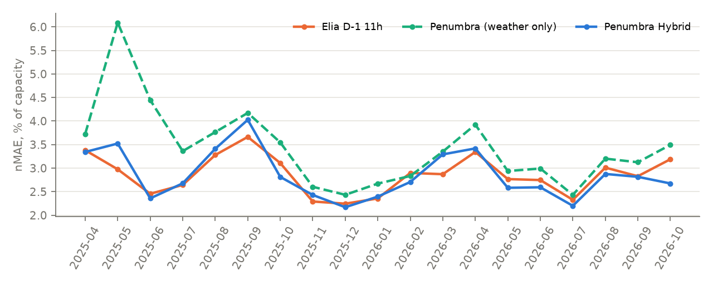
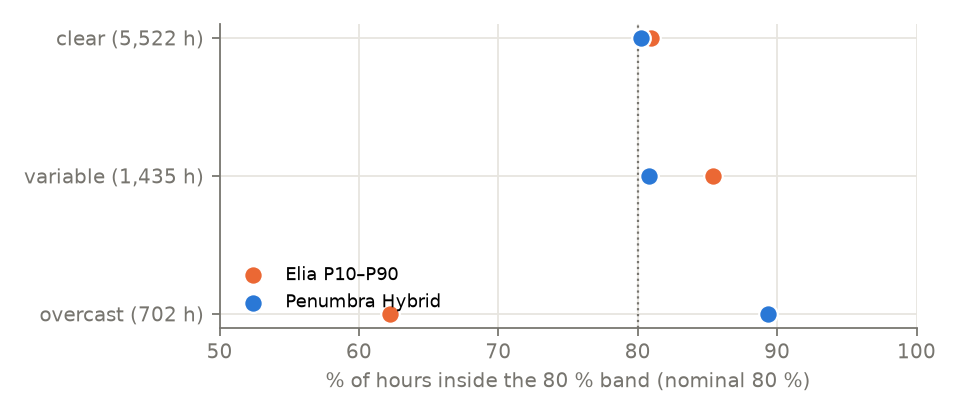
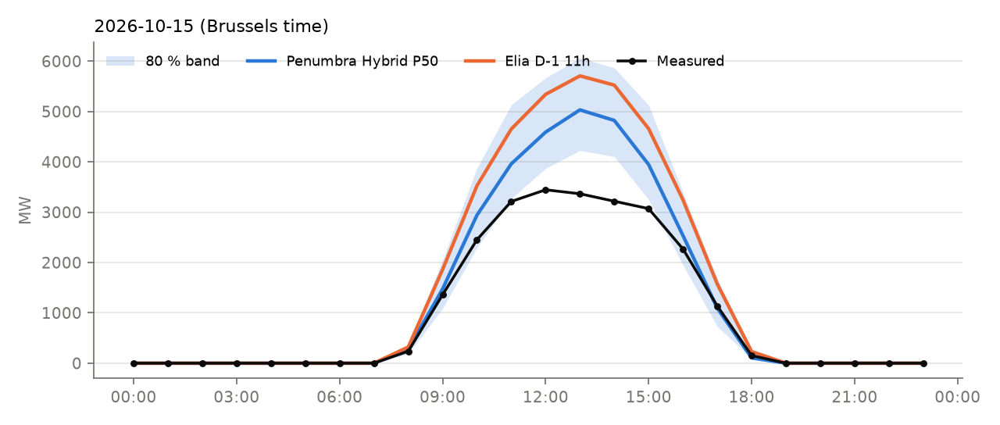

# Evaluation report

*Generated by `scripts/make_report.py` from `reports/*.json` — every number below comes from the committed backtest outputs.*

## Protocol

* **Target:** hourly mean of Elia's upscaled measured PV output for Belgium (MW), expressed as capacity factor on the installed capacity known two days earlier.
* **Benchmark:** Elia's operational day-ahead forecast issued **D-1 at 11:00** (with its P10/P90 band), published in the same Elia dataset.
* **Backtest:** expanding window, one refit per month; test months 2025-04 → 2026-10 (575 days, 7,659 daylight hours). For test month M the quantile models are trained on hours < M − 60 days, conformally calibrated on [M − 60 days, M), then frozen. A unit test (`tests/test_core.py::test_backtest_never_trains_on_test_month`) asserts this.
* **Identical sample:** every method is scored on exactly the same daylight hours (sun elevation > −2°, all forecasts present).
* **Hyperparameters:** fixed a priori (`src/penumbra/model.py::LGB_PARAMS`), never tuned on test months. One feature-design iteration (plane-of-array irradiance, off-day flag, trailing performance ratio, three extra NWP models) was made after the first backtest; it is disclosed here and its effect is visible in the ablation table.

### Two weather-input settings
| Setting | Weather input | Available at D-1 11:00? | Role |
|---|---|---|---|
| **Strict** (headline) | NWP runs issued **48 h** before each valid hour | Yes, for every hour of day D | conservative, leakage-free |
| **Optimistic** | NWP runs issued **24 h** before each valid hour | Only for night/early hours | upper bound on skill |

The live system uses the latest runs available at 10:30 UTC on D-1 (00Z/06Z cycles, 18–42 h old), so live skill should fall between the two settings — and the live track record measures it directly.

## Data quality (`reports/data_quality.json`)
* 22,409 of 22,608 hours have a complete target (0.88 % missing, never imputed); 12,273 daylight hours.
* NWP gaps in daylight hours: aifs 33.46 %, dmi 0.0 %, ecmwf 0.0 %, gem 0.0 %, gfs 0.0 %, icon 0.16 %, knmi 0.0 %, mf 0.0 % (ECMWF AIFS archive starts 2025-03; handled natively by LightGBM).
* Elia D-1 11h forecast missing in 0.17 % of daylight hours.
* Installed PV capacity grew from 9,088 MW to 12,108 MW over the period → the model predicts capacity factor, not MW.
* Night hours with non-zero measured output: 0.

## Results — strict setting (48 h-old weather runs)
| Method | nMAE % cap | nRMSE % cap | MAE MW | bias % cap | MAE skill vs Elia |
|---|---:|---:|---:|---:|---:|
| **Penumbra Hybrid** (weather + Elia 11h) | 2.88 | 4.48 | 335 | +0.07 | -0.2 % |
| **Penumbra** (weather only) | 3.50 | 5.31 | 406 | +0.56 | -21.8 % |
| Elia operational D-1 11h | 2.87 | 4.36 | 335 | +0.07 | — |
| Linear NWP regression | 4.26 | 6.02 | 498 | +0.89 | -48.5 % |
| Climatology (month×hour) | 7.30 | 10.12 | 853 | -1.03 | -154.2 % |
| Persistence (D-2) | 7.76 | 11.92 | 907 | +0.05 | -170.3 % |

| 80 % band | coverage % | mean width % cap | Winkler score | mean pinball (P10/50/90) |
|---|---:|---:|---:|---:|
| **Penumbra Hybrid** (weather + Elia 11h) | 81.2 | 8.87 | 13.18 | 0.919 |
| **Penumbra** (weather only) | 79.7 | 10.86 | 15.80 | 1.110 |
| Elia operational D-1 11h | 80.0 | 12.55 | 14.70 | 0.969 |

### Statistical significance (strict)
| Comparison (A vs B) | DM statistic | p-value | 95 % CI of nMAE(A) − nMAE(B), pp |
|---|---:|---:|---:|
| Weather-only vs Elia D-1 11h | +4.96 | < 0.0001 | [+0.42, +0.89] |
| Weather-only vs Persistence | -13.69 | < 0.0001 | [-4.86, -3.63] |
| Weather-only vs Linear NWP | -6.33 | < 0.0001 | [-1.00, -0.56] |
| Hybrid vs Elia D-1 11h | -0.03 | 0.9765 | [-0.07, +0.10] |
| Hybrid vs Persistence | -16.64 | < 0.0001 | [-5.43, -4.34] |
| Hybrid vs Linear NWP | -10.05 | < 0.0001 | [-1.64, -1.16] |

## Results — optimistic setting (24 h-old weather runs)
| Method | nMAE % cap | nRMSE % cap | MAE MW | bias % cap | MAE skill vs Elia |
|---|---:|---:|---:|---:|---:|
| **Penumbra Hybrid** (weather + Elia 11h) | 2.74 | 4.25 | 319 | -0.01 | +4.6 % |
| **Penumbra** (weather only) | 3.08 | 4.68 | 358 | +0.24 | -7.3 % |
| Elia operational D-1 11h | 2.87 | 4.36 | 335 | +0.07 | — |
| Linear NWP regression | 3.90 | 5.51 | 454 | +0.62 | -35.7 % |
| Climatology (month×hour) | 7.30 | 10.12 | 853 | -1.03 | -154.2 % |
| Persistence (D-2) | 7.76 | 11.92 | 907 | +0.05 | -170.3 % |

| 80 % band | coverage % | mean width % cap | Winkler score | mean pinball (P10/50/90) |
|---|---:|---:|---:|---:|
| **Penumbra Hybrid** (weather + Elia 11h) | 81.2 | 8.55 | 12.51 | 0.873 |
| **Penumbra** (weather only) | 79.4 | 9.59 | 13.71 | 0.971 |
| Elia operational D-1 11h | 80.0 | 12.55 | 14.70 | 0.969 |

### Statistical significance (optimistic)
| Comparison (A vs B) | DM statistic | p-value | 95 % CI of nMAE(A) − nMAE(B), pp |
|---|---:|---:|---:|
| Weather-only vs Elia D-1 11h | +1.09 | 0.2735 | [-0.01, +0.49] |
| Weather-only vs Persistence | -14.77 | < 0.0001 | [-5.30, -4.03] |
| Weather-only vs Linear NWP | -8.06 | < 0.0001 | [-1.01, -0.65] |
| Hybrid vs Elia D-1 11h | -2.57 | 0.0103 | [-0.22, -0.02] |
| Hybrid vs Persistence | -17.02 | < 0.0001 | [-5.58, -4.47] |
| Hybrid vs Linear NWP | -9.30 | < 0.0001 | [-1.40, -0.94] |

## Where the errors are (strict)
By forecast sky regime (forecast clear-sky index; nMAE in % of capacity, coverage of the 80 % band in %):

| regime   |   elia_da11 |   pen_q50 |   hyb_q50 |   n_hours |   elia_da11_coverage |   pen_q50_coverage |   hyb_q50_coverage |
|:---------|------------:|----------:|----------:|----------:|---------------------:|-------------------:|-------------------:|
| overcast |        1.11 |      1.35 |      1.11 |       702 |                62.25 |              90.17 |              89.32 |
| variable |        3.29 |      3.65 |      3.29 |      1435 |                85.37 |              81.46 |              80.84 |
| clear    |        2.99 |      3.73 |      2.99 |      5522 |                80.93 |              77.85 |              80.21 |

By season:

| season   |   elia_da11 |   pen_q50 |   hyb_q50 |   n_hours |   elia_da11_coverage |   pen_q50_coverage |   hyb_q50_coverage |
|:---------|------------:|----------:|----------:|----------:|---------------------:|-------------------:|-------------------:|
| DJF      |        2.51 |      2.65 |      2.43 |       825 |                84.12 |              78.67 |              77.09 |
| JJA      |        2.73 |      3.36 |      2.67 |      2942 |                77.84 |              81.14 |              82.05 |
| MAM      |        3.06 |      4.05 |      3.22 |      2205 |                75.65 |              78.05 |              81.59 |
| SON      |        3.05 |      3.43 |      3.01 |      1687 |                87.67 |              79.67 |              81.03 |

## Ablations (strict, weather-only median model, nMAE % of capacity)
| Variant | nMAE % cap |
|---|---:|
| Full weather-only model (8 NWP models, spread, POA, trailing ratio) | 3.499 |
| … without ECMWF AIFS (AI weather model) | 3.602 |
| … without multi-model spread / spatial dispersion | 3.511 |
| ECMWF IFS only | 3.925 |
| ICON only | 4.292 |

Top features by gain (strict weather-only model): `poa_s35` (29.6 %), `poa_ew` (10.3 %), `ghi_ecmwf` (7.8 %), `ghi_ens` (7.7 %), `ghi_icon` (3.7 %), `ghi_mf` (3.1 %), `pr_trail` (2.5 %), `doy_cos` (1.9 %).

## Impact translation (strict, see `src/penumbra/impact.py`)
| Quantity | Elia D-1 11h | Penumbra Hybrid | Penumbra weather-only |
|---|---:|---:|---:|
| Absolute error energy, GWh/yr | 1,633 | 1,633 | 1,980 |
| P99 hourly over-forecast, MW | 1,539 | 1,618 | 1,895 |
| Imbalance cost of error, €/MWh produced | 7.71 | 7.45 | 7.50 |
| Imbalance cost of error, M€/yr (fleet) | 95.0 | 91.8 | 92.4 |

Assumptions: one balance-responsible party schedules the whole fleet day-ahead at the forecast and settles deviations at Elia's single imbalance price, as a price-taker. This is an illustration of the order of magnitude, not a market simulation.

## Example day

